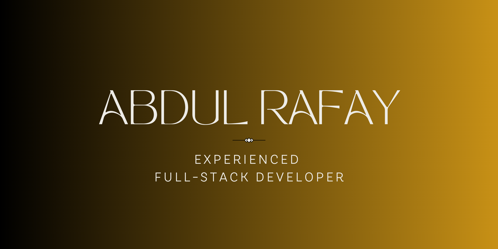

 

###  Hi, I'm Abdul Rafay

**Full Stack Developer & Backend Engineer** building production systems in the PERN stack, self-taught since 16, currently deepening my system architecture and AI integration skills.

📍 Pakistan &nbsp;|&nbsp;  Decigence.AI (Melbourne, remote) &nbsp;|&nbsp;  abdulrafay037@gmail.com

***

###  What I Do

I'm a **Junior Full Stack Developer / Software Engineer (Backend)** at **Decigence.AI**, a Melbourne-based company, working remotely from Pakistan. I build and maintain production systems across the full stack, with a focus on backend architecture, performance optimization, and cost-conscious AI integration.

**A few things I've shipped in production:**
-  Optimized a core caching layer with **Redis**, cutting latency from **300ms to 12ms**
-  **Dockerized** the full production environment for consistent, reliable deployment
-  Built a hybrid AI routing system using **Ollama as a local pre-filter** before falling back to paid APIs, cutting AI operational costs significantly

Outside of work, I'm self-taught across my entire stack, starting with GW-BASIC as a kid, and currently pursuing a BSCS alongside full-time work. I'm especially drawn to system architecture as a discipline, treating it as a long-term, AI-resilient career direction rather than just another skill to pick up.

***

###  Tech Stack

**Languages**

**Frontend**

**Backend**

**Databases**

**DevOps & Tools**

**AI / ML**

***

###  Currently Building

**[Visual Symptom Explorer](https://github.com/abdulrafay17/visual-symptom-explorer)**: an interactive 3D human anatomy explorer built with React, Three.js, and a self-hosted Ollama pipeline. Users explore a fully rotatable, medically-detailed 3D model to get structured, educational explanations of symptoms, never a diagnosis. Built on 1300+ classified anatomical structures with a custom region-mapping system and Draco-optimized 3D assets.

***

###  GitHub Stats

***

###  What I'm Learning Next

- Deepening system architecture and distributed systems design
- Layering LLM APIs, vector databases, and LangChain onto my existing full stack skills
- AWS Solutions Architect fundamentals

***

 **Reach me:** abdulrafay037@gmail.com &nbsp;|&nbsp;  **Portfolio:** [rafay-developer.vercel.app](https://rafay-developer.vercel.app)

